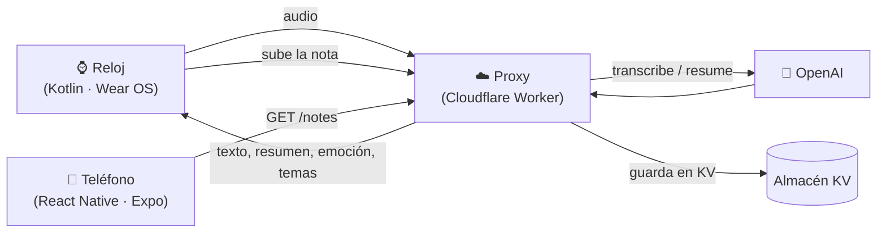

# Diario de Voz

Diario personal que se maneja con la voz. Grabas una nota en tu **reloj Wear OS**, una IA la **transcribe**, la **resume** y detecta la **emoción** y los **temas**, y la nota aparece automáticamente en la **app del teléfono**, donde se ve como una lista y como una constelación.


---

## Qué hace

**En el reloj**
- Graba notas de voz y permite reproducirlas.
- Transcribe y analiza cada nota con IA: resumen corto, emoción y hasta 4 temas.
- Guarda un historial con el detalle de cada nota.
- Sube cada nota ya analizada para que el teléfono la reciba.

**En el teléfono**
- Muestra la lista de notas y una vista de **constelación** por emociones.
- Recibe las notas del reloj de forma automática (al abrir la app y cada 15 segundos), con una etiqueta **"reloj"**.
- También permite grabar notas directamente desde el teléfono.

---

## Cómo se conectan reloj y teléfono

Las dos apps no se hablan directamente: usan un **proxy** como puente. Así funciona en emuladores y en dispositivos reales, sin emparejar por Bluetooth.



1. El reloj graba la nota y envía el audio al proxy.
2. El proxy lo transcribe y lo analiza con OpenAI, y devuelve el resultado al reloj.
3. El reloj sube la nota terminada al proxy, que la guarda.
4. El teléfono consulta el proxy y muestra las notas nuevas.

El proxy guarda la clave de OpenAI para que **nunca viaje dentro de las apps**. Las apps solo conocen la URL del proxy y un token compartido.

---

## Estructura del repositorio

```
diario-voz/
├── reloj/       App de Wear OS (Kotlin + Jetpack Compose)
├── telefono/    App móvil (React Native + Expo)
├── proxy/       API intermedia (Cloudflare Workers + KV)
└── README.md
```

| Carpeta | Tecnologías |
|---|---|
| `reloj/` | Kotlin, Jetpack Compose for Wear OS, Android 11 o superior (API 30+) |
| `telefono/` | React Native, Expo (expo-router, expo-sqlite, expo-audio), TypeScript |
| `proxy/` | JavaScript, Cloudflare Workers, Cloudflare KV, API de OpenAI |

Modelos de OpenAI usados: `whisper-1` para transcribir y `gpt-5.4-mini` para resumir y clasificar. Se pueden cambiar sin tocar el código (ver `proxy/README.md`).

---

## Requisitos

- **Android Studio** reciente, con un emulador de Wear OS (por ejemplo *Wear OS Small Round*).
- **Node.js 20 o superior** y npm.
- Una cuenta de **OpenAI** con saldo de API. Es distinta de ChatGPT Plus.
- Una cuenta gratuita de **Cloudflare**.
- Un emulador de Android o la app **Expo Go** para el teléfono.

---

## Puesta en marcha

### 1. Proxy (Cloudflare + OpenAI)

Guía completa, paso a paso, en [`proxy/README.md`](proxy/README.md). En resumen:

```powershell
cd proxy
npx wrangler login
npx wrangler secret put OPENAI_API_KEY    # tu clave sk-... de OpenAI
npx wrangler secret put APP_TOKEN         # una frase que tú inventas
node actualizar.mjs TU-TOKEN              # crea el almacén KV, despliega y comprueba
```

`APP_TOKEN` es una contraseña que **tú inventas**: no es la clave de OpenAI. Al terminar, el script imprime la **URL del proxy**. Guárdala junto con el token.

Antes de continuar, comprueba que el proxy funciona:

```powershell
node probar.mjs https://TU-URL.workers.dev TU-TOKEN
```

### 2. Reloj

1. Abre la carpeta `reloj/` en Android Studio.
2. Edita `app/src/main/java/com/diariovoz/watch/Config.kt`:
   ```kotlin
   const val API_URL = "https://TU-URL.workers.dev"
   const val API_TOKEN = "tu-token"
   ```
3. Elige un emulador de Wear OS y pulsa ▶.

Si `API_URL` se deja vacío, la app funciona en **modo demo**, con datos simulados y sin internet.

### 3. Teléfono

```powershell
cd telefono
npm install
copy .env.example .env.local
```

Edita `.env.local`:

```
EXPO_PUBLIC_API_URL=https://TU-URL.workers.dev
EXPO_PUBLIC_API_TOKEN=tu-token
```

```powershell
npx expo start -c
```

Abre la app en un emulador o en Expo Go. Sin `.env.local`, también arranca en modo demo, pero no sincroniza con el reloj.

---

## Cómo probar el enlace reloj ↔ teléfono

1. Graba una nota corta en el reloj, hablando de cómo te fue el día.
2. Espera a que el reloj muestre el resumen y la emoción.
3. Abre la app del teléfono. Si la nota no aparece, desliza hacia abajo en la lista para sincronizar.
4. Debe verse con la etiqueta **"reloj"**, con su transcripción, resumen, emoción y temas.

Puede tardar unos segundos, y hasta aproximadamente un minuto, en reflejarse.

---

## Limitaciones conocidas

- **El enlace pasa por internet** (reloj → proxy → teléfono); no es una conexión directa por Bluetooth. Ambos dispositivos necesitan conexión.
- **Solo se sincroniza el texto**: transcripción, resumen, emoción y temas. El audio se queda en el reloj, así que las notas del reloj no se pueden reproducir en el teléfono.
- **Las notas del reloj se borran desde el reloj.** Borrarlas en el teléfono no está permitido porque el reloj las reenviaría.
- **Es un sistema de un solo usuario:** todos los dispositivos con el mismo token comparten las mismas notas. Se conservan las últimas 200.
- **Privacidad:** el audio y el texto de las notas se envían a OpenAI para procesarlos. No uses el proyecto con información sensible.
- El token viaja dentro de las apps, por lo que **no es una seguridad fuerte**. Conviene fijar un límite mensual de gasto en OpenAI.

---

## Seguridad y secretos

- La clave de OpenAI vive solo en Cloudflare, como secreto del Worker.
- `.env.local`, `.dev.vars` y los archivos de compilación están en el `.gitignore` y **no deben subirse**.
- En `Config.kt` el repositorio incluye `API_URL` y `API_TOKEN` vacíos a propósito.

---

## Problemas frecuentes

| Síntoma | Causa probable | Solución |
|---|---|---|
| El reloj dice *No se pudo conectar: No encuentra el servidor* | El emulador perdió el DNS, o la URL está mal escrita | **Cold Boot Now** en el Device Manager; revisa que la URL sea la completa que imprimió el despliegue |
| `401 Token inválido` | El token no coincide | Debe ser idéntico en el proxy, `Config.kt` y `.env.local` |
| La app del teléfono avisa *Método no permitido* | El proxy desplegado es una versión vieja | Vuelve a desplegar con `node actualizar.mjs TU-TOKEN` |
| Las notas del reloj no llegan al teléfono | El proxy no tiene el almacén KV | Ejecuta `node actualizar.mjs TU-TOKEN` |
| `502 La clave de OpenAI no es válida` | Clave mal guardada | Repite `npx wrangler secret put OPENAI_API_KEY` |
| `502 ... sin saldo o límite alcanzado` | Sin crédito en OpenAI | Revisa *Billing* en platform.openai.com |
| Cambié `.env.local` y no pasa nada | Expo guarda las variables en caché | Reinicia con `npx expo start -c` |

---

## Autoría

**Edgar Villagrana** — [IDGS] — [2026]
